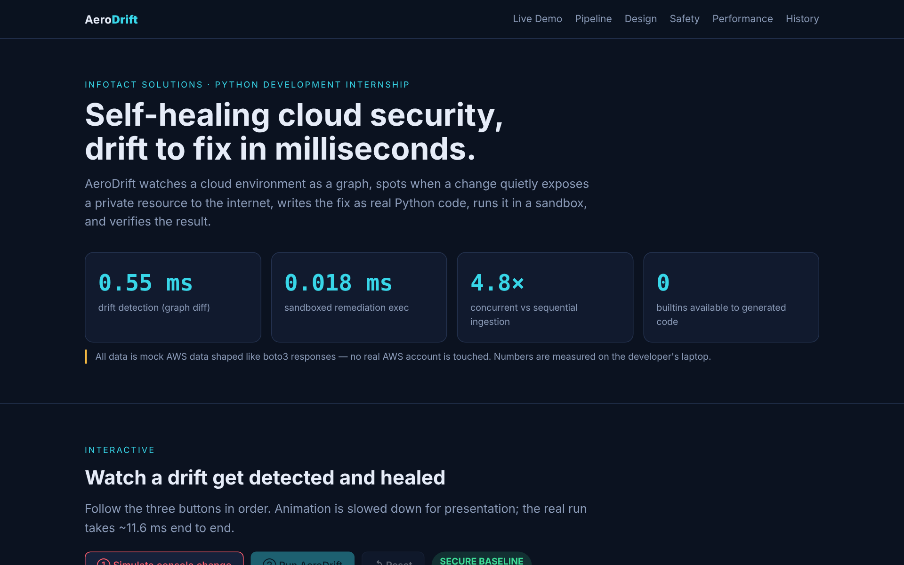
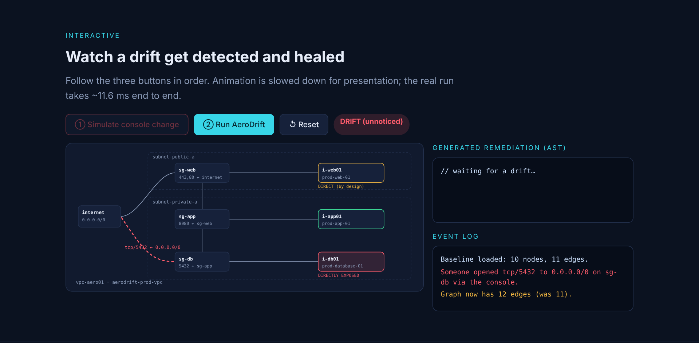
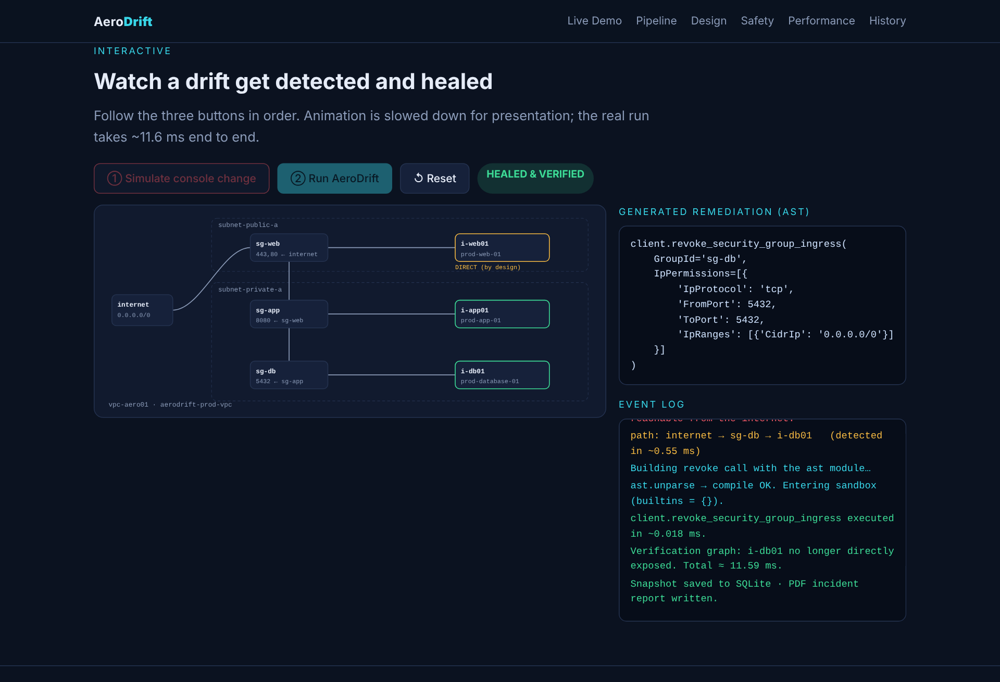
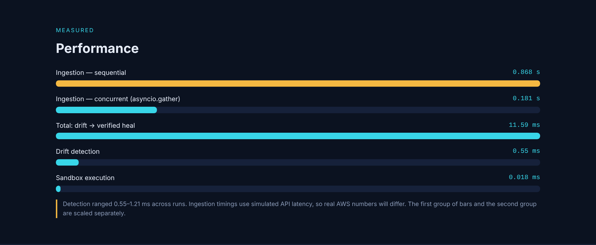
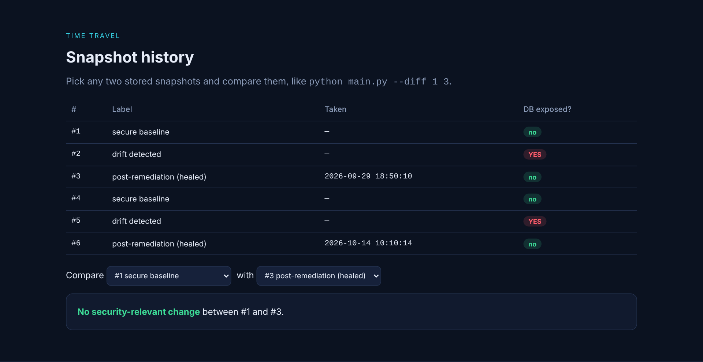

# 🛰️ AeroDrift

**Self-healing cloud security: detect configuration drift, generate the fix as code, run it safely, verify it.**

A single changed firewall rule in a cloud console can quietly expose a private database to the whole internet. AeroDrift models the cloud as a graph, notices that kind of change within about a millisecond, writes the remediation as real Python (using the `ast` module), runs it in a locked-down sandbox, and checks that the exposure is gone.


> **Data note:** AeroDrift runs on **mock AWS data** shaped like `boto3` responses. No real AWS account is touched. All timings below were measured on a developer laptop.

---

## 📸 Dashboard

An interactive web dashboard (`AeroDrift_Dashboard.html`) walks through the whole system. Open it directly in a browser: no server, no install.



**Step 1: a drift happens.** Someone opens `tcp/5432` to `0.0.0.0/0` on the database security group. Nothing crashes, but the database is now directly exposed.



**Step 2: AeroDrift detects it, generates the fix, runs it in the sandbox, and verifies.**



---

## ⚡ Results at a Glance

| Metric | Result |
|---|---|
| Drift detection (graph diff) | **0.55 ms** (0.55–1.21 ms across runs) |
| Sandboxed remediation execution | **0.018 ms** |
| Drift → verified heal, end to end | **11.59 ms** |
| Ingestion, sequential vs concurrent | 0.868 s → **0.181 s** (**4.79× faster**) |
| Baseline topology | 10 nodes, 11 edges (12 edges once drift is injected) |
| False alarms on a healthy 3-tier app | **0** |
| Builtins available to generated code | **0** |

*Ingestion timings use simulated API latency, so real AWS numbers will differ.*



---

## 🏗️ Architecture

```
Mock AWS ──► Async ingestion ──► NetworkX graph ──► Drift detector ──► AST code generator
(boto3-shaped)  (asyncio.gather)   (topology)        (state diff)            │
                                                                             ▼
        PDF incident report ◄── SQLite snapshots ◄── Verification ◄── Sandboxed execution
```

| Week | Module | What it does |
|---|---|---|
| 1 | `week1_ingestion/` | Concurrent fetch of VPCs, subnets, security groups and instances; builds a directed topology graph |
| 2 | `week2_drift_detection/` | Compares two snapshots, ranks CRITICAL / WARNING / INFO, renders a Rich terminal tree |
| 3 | `week3_remediation/` | Generates the boto3 fix with `ast`, executes it in a sandbox, verifies on a fresh graph |
| 4 | `week4_persistence/` | SQLite snapshot history with time-travel diffs; PDF incident reports; unified `main.py` daemon |

---

## 🧠 Key Design Decisions

### 1. Direct exposure vs transitive reachability
A naive "is there any path from the internet?" check flags every healthy 3-tier app, because `web → app → db` *is* a path. AeroDrift separates:
- **Direct exposure:** the instance's own security group accepts traffic from `0.0.0.0/0`.
- **Transitive reachability:** reachable only by pivoting through another tier.

The secure baseline therefore raises zero alerts, and a real drift stands out.

### 2. Drift is the difference between two states
Instead of re-scanning rules, drift is the diff of two exposure maps. That keeps detection near a millisecond and means any two stored snapshots can be compared later.

### 3. `ast` instead of f-strings for code generation
String-built code breaks on quotes and is easy to inject into. AeroDrift builds the call as a syntax tree (`ast.Call`, `ast.keyword`, `ast.Constant`, …) and converts it with `ast.unparse`, so the generated code is structurally valid by construction. Generated output:

```python
client.revoke_security_group_ingress(
    GroupId='sg-db',
    IpPermissions=[{
        'IpProtocol': 'tcp',
        'FromPort': 5432,
        'ToPort': 5432,
        'IpRanges': [{'CidrIp': '0.0.0.0/0'}]
    }]
)
```

---

## 🔒 Sandbox Safety

Generated code runs with `__builtins__ = {}` and only the `client` object in scope. A malicious snippet cannot even call `open()`. Real attack-test output:

```
Sandbox correctly blocked it: Sandboxed remediation failed: name 'open' is not defined
```

> ⚠️ **Honest caveat:** this is a guardrail, not a complete security boundary. Determined Python escapes exist. In production, remediation would also need a human approval step, least-privilege IAM credentials, and stronger isolation (a container or separate process).

---

## 🕰️ Snapshot History (time travel)

Every state is stored in SQLite, so any two moments can be compared.



```bash
python main.py --history        # list stored snapshots
python main.py --diff 1 3       # compare snapshot 1 with 3
```

Example: `--diff 1 3` (secure baseline vs post-remediation) reports **no security-relevant change**, confirming the heal restored the original state.

---

## 📁 Project Structure

```
aerodrift/
├── week1_ingestion/
│   ├── mock_aws_environment.py   # baseline state + drift injection
│   ├── aws_ingestion.py          # async concurrent fetchers
│   └── topology_graph.py         # NetworkX graph + exposure queries
├── week2_drift_detection/
│   ├── drift_detector.py         # state-diff detector with severities
│   └── rich_dashboard.py         # terminal topology tree + drift report
├── week3_remediation/
│   ├── mock_aws_client.py        # revoke_security_group_ingress stub
│   ├── code_generator.py         # ast-based fix generator
│   ├── execution_sandbox.py      # builtins-free exec
│   └── self_heal_demo.py         # detect → generate → execute → verify
├── week4_persistence/
│   ├── state_history.py          # SQLite snapshots + diffs
│   └── incident_report.py        # PDF incident reports
├── docs/screenshots/             # dashboard screenshots used in this README
├── AeroDrift_Dashboard.html      # standalone interactive dashboard
├── main.py                       # unified daemon entry point
└── requirements.txt
```

---

## 🚀 Getting Started

```bash
conda create -n aerodrift python=3.11 -y
conda activate aerodrift
pip install -r requirements.txt     # networkx, rich, reportlab

python main.py                      # full pipeline: ingest → detect → heal → persist → report
python main.py --history
python main.py --diff 1 3
```

Open `AeroDrift_Dashboard.html` in any browser for the interactive walkthrough.

---

## 🔭 Future Work

- Swap the mock fetchers and client for real `boto3` calls
- Detect more drift types (public S3 buckets, IAM policy changes)
- Add a human approval step before remediation runs
- Stronger isolation for generated code (container or separate process)

---

## 🛠️ Tech Stack

Python · asyncio · NetworkX · `ast` · SQLite · Rich · reportlab

---

*Built during a Python Development internship at **Infotact Solutions**: four weeks, daily commits, verified end to end at every step.*
